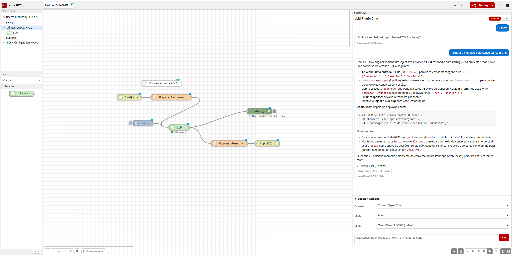

# @dae/node-red-llm

Node-RED nodes and an editor sidebar for any OpenAI-compatible `/chat/completions` endpoint
(e.g. GLM-5.3-Flash, Qwen3.8).

## Install

The package is published to the DAE Nexus npm registry. In the Node-RED user directory
(e.g. `/data` in the `nodered/node-red` image):

```sh
echo "@dae:registry=https://nexus.dtx-colab.com/repository/dae-node/" >> .npmrc
npm install @dae/node-red-llm
```

Then restart Node-RED.

## Nodes

### llm-config (configuration)

| Field   | Description                                                        |
|---------|--------------------------------------------------------------------|
| URL     | Full chat completions URL, e.g. `https://host/v1/chat/completions` |
| Model   | Model id sent in the request, e.g. `zai-org/GLM-5.3-Flash`         |
| API key | Bearer token, stored encrypted with the Node-RED credentials       |
| Timeout | Request timeout in ms (default 120000)                             |

No environment variables are read; everything is configured on this node.

### llm-chat

Sends `msg.payload` to the model and returns the reply.

| Input           | Description                                                                 |
|-----------------|-----------------------------------------------------------------------------|
| `msg.payload`   | Prompt string, or a full array of chat messages (`{role, content}`)          |
| `msg.system`    | Optional, overrides the configured system prompt                            |
| `msg.llmParams` | Optional, extra request fields merged into the body (`tools`, `top_p`, ...) |

| Output          | Description                                      |
|-----------------|--------------------------------------------------|
| `msg.payload`   | Assistant reply (parsed object in JSON mode)     |
| `msg.llm`       | Raw completion response, including `usage`        |
| `msg.toolCalls` | Tool calls requested by the model, if any         |

Options: system prompt, temperature, max tokens, JSON mode and removal of `<think>` reasoning blocks.

## LLM Plugin sidebar

An **LLM Plugin** tab in the editor sidebar to chat with the model about the open flow.



- **Model**: any deployed `llm-config` node.
- **Context**: send the current flow tab (without credentials) or nothing.
- **Mode**:
  - *Ask* answers questions.
  - *Agent* returns the complete updated flow and applies it to the open tab. Every applied change
    keeps a **Restore Checkpoint** and can also be undone with Ctrl+Z. Deploy to apply it to the runtime.
- Chats are stored in the browser (`localStorage`).

Subflows are not supported by the agent.

## Publish

```sh
npm login --registry=https://nexus.dtx-colab.com/repository/dae-node/ --auth-type=legacy
npm version patch
npm publish
```
